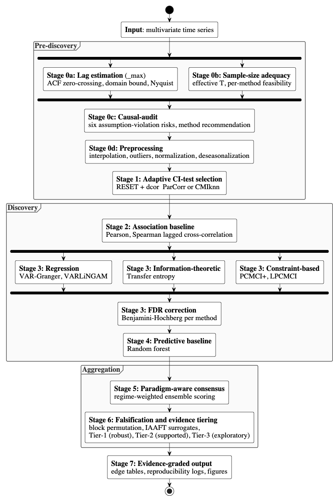

# AutoCause: Framework & Pipeline

This document describes the full AutoCause pipeline: the end-to-end architecture
and the 21-step workflow spanning data preparation, causal discovery, and
validation. It expands on the at-a-glance overview in the main
[README](../README.md).

## Pipeline

**A. Data and assumptions**

1. **τmax estimation**: ACF zero-crossing, domain constraint, Nyquist bound
2. **Sample size adequacy**: method-specific *T*min checks, CI-test fallback
3. **Preprocessing**: outlier removal, interpolation, normalization, stationarity check
4. **Deseasonalization** (optional): rolling-mean subtraction to remove annual cycles
5. **[causal-audit](https://github.com/marcoruizrueda/causal-audit)** (optional): assumption diagnostics, risk scores, method recommendation
6. **Distribution tests**: Gaussianity, linearity → CI test recommendation
7. **Correlation analysis**: Pearson, Spearman, distance correlation (symmetric baseline)

**B. Discovery**

<!-- continued from A -->

8. **VAR-based Granger causality**: conditional *F*-tests (all controls for *N* ≤ 10)

9. **PCMCI+**: momentary conditional independence with adaptive CI test

10. **LPCMCI**: PCMCI+ extended for latent confounders (outputs PAG)

11. **VAR-LiNGAM**: ICA on VAR residuals (non-Gaussian identifiability)

12. **Transfer entropy**: *k*-NN conditional mutual information with surrogate *p*-values

13. **RF-baseline**: Random Forest feature importance (non-causal comparison)

**C. Validation and synthesis**

<!-- continued from B -->

14. **Graph recovery evaluation**: F1, SHD, AUROC, AUPRC against ground truth (when available)

15. **Ensemble scoring**: confidence-weighted aggregation across methods (regime-adaptive weights)

16. **Power analysis**: minimum detectable effect size (MDES) per method

17. **CI-test sensitivity**: compare edges across ParCorr / RobustParCorr / CMIknn

18. **Falsification**: block permutation + IAAFT surrogate tests

19. **ICP stability**: coefficient stability across environments

20. **Consensus**: multi-method voting with lag tolerance

21. **Tiered classification**: edges ranked by evidence strength
